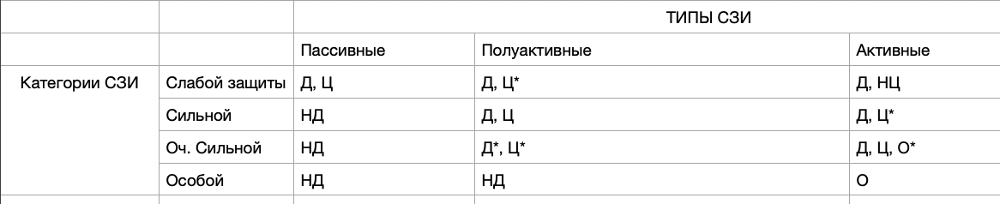
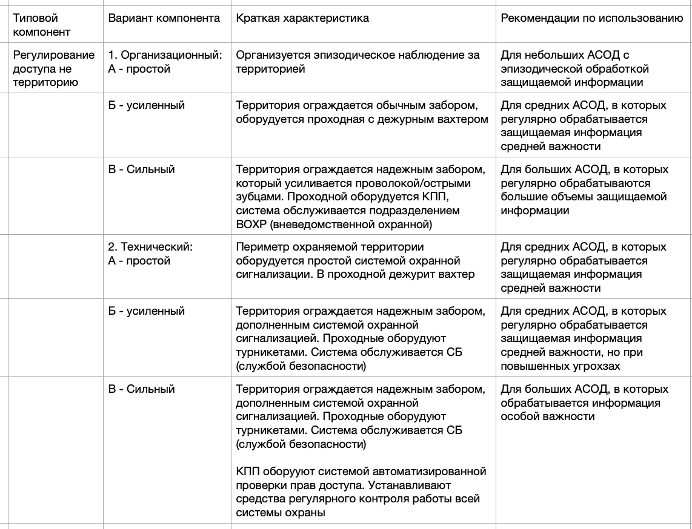

# Продолжаем про СЗУ
* На высшем и среднем уровне нужно осуществить системную классификацию СЗИ

* Они классифицируются:
  * По уровню защиты, которую обеспечивает система. Выделют 4 категории СЗИ:
    * Слабой защиты. Они рассчитаны на такие АСОД, которые обрабатывают информацию с низким уровнем конфиденциальности
    * Сильной защиты. Рассчитаны на АСОД, в которых обрабатывается информация, защищаемая от НСД, но объемы ее невилики, а обрабатывается она эпизодически
    * Очень сильной защиты. Рассчитаны на АСОД, в которых регулярно обрабатываются большие объемы конфиденциальной информации
    * Особой защиты. Рассчитаны на АСОД, в которых регулярно обрабатывается информация повышенной секретности
  * По активности реагирования системы на НСД. Их 3 типа:
    * Пассивные. СЗИ, в которых не предусмотрена ни сигнализация о несанкционированных действиях, не воздействия на нарушителя
    * Активные. СЗИ, в которых предусмотрены и сигнализация, и система воздействия на нарушителя
    * Полуактивные. В них предусмотрена сигнализация, но не система воздействия на нарушителя

* В общем случае, можно предположить, что СЗИ каждой категории по уровню защиты могут относиться к разным типам реагирования. Однако, целесообразно строить СЗИ слабой защиты с активным реагированием, хотя в некоторых случаях они допустимы.

* С другой стороны, СЗИ особой защиты должны быть с активной реакцией

* Допустимые типы СЗИ для различных категорий:

* В таблице:
  * О - обязательные
  * Ц - целесообразные
  * НЦ - нецелесообразные
  * Д - допустимые
  * НД - недопустимые
  * "*" - в отдельных случаях

* Для формирования полного множества потенциально необходимых СЗИ нужно принять во внимание еще один критерий - тип АСОД, для которой СЗИ создается.

* Типы АСОД
  * ПК, используемые локально
  * ПК, используемый локально, но доступ к нему есть у неск. человек
  * Локальная вычислительаня сеть
  * Слабо распределенная локальная сеть (на малой территории)
  * Сильно распределенная вычислительная сеть
  * Гобальная вычислительная сеть

## Типизация и стандартизация на среднем уровне

* Предполагает разработку типовых проектов для структурно и функционально ориентированных компонентов СЗИ, которые могут быть аттестованы в качестве стандартных, из которых можно сравнительно просто собирать необходимую СЗИ

* В качесвте структурно ориентированных компонентов естественно выбирать компоненты СЗИ, каждый из которых ориентирован на ЗИ в конкретном типовом структурном компоненте АСОД. И для каждого типового структурного компонента должны быть разработаны варианты типовых компонентов СЗИ, ориентированы на разные уровни защиты информации

* В качесвте типовых функционально ориентированных могут быть выделены следующие компоненты:
  * Регулирование доступа на территорию, отдельные помещения, к тех. средствам АСОД, к программам и массивам данных
  * Подавление излучений и наводок
  * Предупреждение наблюдения и подслушивания
  * Маскировки информации
  * Управления системой защиты

* С целью создания максимальных удобств для разработчиков СЗИ эти компоненты представляют в формате различных модификаций

## Типизация и стандартизация на низшем уровне

* Предполагает разработку и стандартизацию типовых проектных решений по практической реализации средств защиты информации.

* Покомпонентная стандартизация СЗИ представляет собой вариант, основанный на семирубежной модели. При этом организационное построение СЗИ в общем случае можно представить совокупностью следующих 7 рубежей защиты:
  1. Защита территории, занимаемой АСОД
  2. Защита зданий, расположенных на территории
  3. Защита помещений внутри здания, в которых расположены ресурсы АСОД и защищаемая информация
  4. Ресурсы, используемые для хранения и обработки информации и сама защищаемая информация
  5. Защита линий связи, проходящих в пределах одного и того же здания
  6. Защита линий связи, проходящих между различными зданиями, расположенными на одной и той же охраняемой территории
  7. Защита линий связи, проходящих по неконтролируемой территории

* При этом, рубеж защиты - организованная совокупность методов, средств и мероприятий, используемых на соответствующем элементе для защиты информации в АСОД.

* В надлежащем сочитании перечисленных рубежей может быть представлена СЗИ любой АСОД. А каждый из рубежей защиты - с помощью типовых проектных решений.